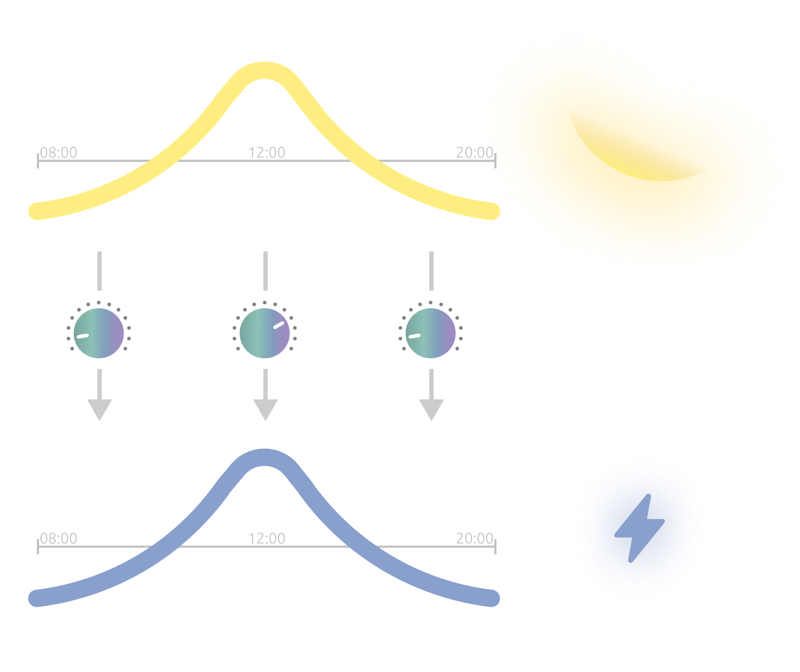
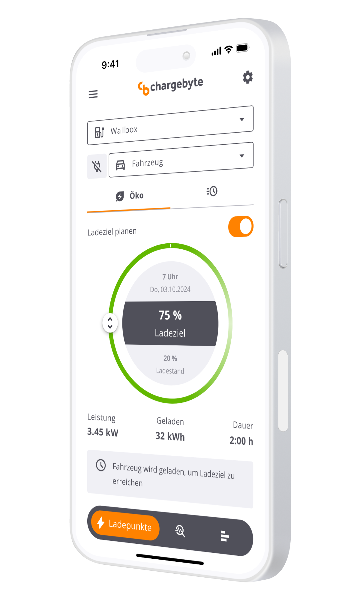
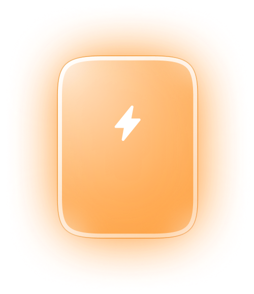

.. _doc-overview-nymea-as-hems:

nymea as HEMS
=============

In recent years, nymea has increasingly been used as a (Home) Energy Management System (HEMS) due to its maturity and interoperability. It connects energy devices from different manufacturers on a local Linux-based system, making their data and controls available in one place.

This gives households and product makers a foundation for coordinating solar generation, electricity consumption, storage and electric vehicle charging. nymea's integration model can be used in a dedicated home controller or directly on an embedded device such as a smart charger.

.. only:: html

   .. raw:: html

      

        <iframe src="../../animations/energy-flow/index.html"
                title="Animated energy flows coordinated by Energy Management software"
                loading="lazy"
                style="position:absolute;inset:0;width:100%;height:100%;border:0;border-radius:16px;"
                allow="fullscreen"></iframe>
      

.. only:: not html

   .. image:: ../../../static/animations/energy-flow/poster.svg
      :alt: Energy Management software coordinates solar, grid, home, smart meter, EV charging and an app.
      :width: 100%

Mint streams show electricity flowing between devices. Lilac and blue pulses show data and control exchanged with the central energy management software. The flows are illustrative; electricity does not pass through the software.

Make more use of solar energy
-----------------------------

nymea can bring together data from photovoltaic inverters and smart meters with controllable loads such as EV chargers. In a PV surplus charging setup, the available solar power can be used to adjust the charging current instead of drawing unnecessary power from the grid. Supported integrations can also expose battery storage and other energy devices, allowing a system to coordinate more of the home's energy flows. Product-specific functions such as bidirectional charging and vehicle state-of-charge data require compatible chargers and vehicles.

   PV surplus charging follows the power available from the sun.

Keep charging within the available power
----------------------------------------

For homes and charging sites with limited electrical capacity, energy management can distribute power across chargers and reduce charging power as other loads increase. This supports dynamic load balancing, peak reduction and protection of the building connection from overload. The available behavior depends on the connected meter, charger and deployment configuration.

Use flexible electricity tariffs
--------------------------------

Where a dynamic tariff and the necessary pricing data are available, a nymea-based energy solution can schedule flexible loads for lower-cost periods. nymea supports tariffs based on EPEX Spot prices. This can complement PV surplus charging when solar generation is insufficient.

Simple setup and local control
------------------------------

nymea's local-first architecture keeps device communication and automation in the local network. Its integration plugins provide a common model for meters, inverters, chargers and other devices, while :doc:`nymea:app <../users/installation/app>` (or derivates) offers a user-facing way to configure and control a system. Supported discovery and setup flows can avoid manual network configuration and low-level protocol settings.

   Example of the CB Energy App, a derivate of nymea:app.

Built for embedded products
---------------------------

nymea:core can run on Linux-based hardware, including embedded controllers in charging equipment. Its APIs and integration plugins give manufacturers a way to connect devices and build product-specific applications without starting the device integration layer from scratch. This is the approach behind chargebyte's controller, embedded application and app offerings.

   A charger can host local energy management software.

Explore :doc:`energy integrations <../resources/integrations/category-energy>`, :doc:`nymea's platform features <features>` and the :doc:`developer documentation <../developers/index>` for the available building blocks. Specific energy management functions depend on the chosen hardware, integrations and product configuration.

More info on chargebyte offering based on nymea at `chargebyte's energy landing page <https://en.chargebyte.energy/>`__ (© chargebyte GmbH).
